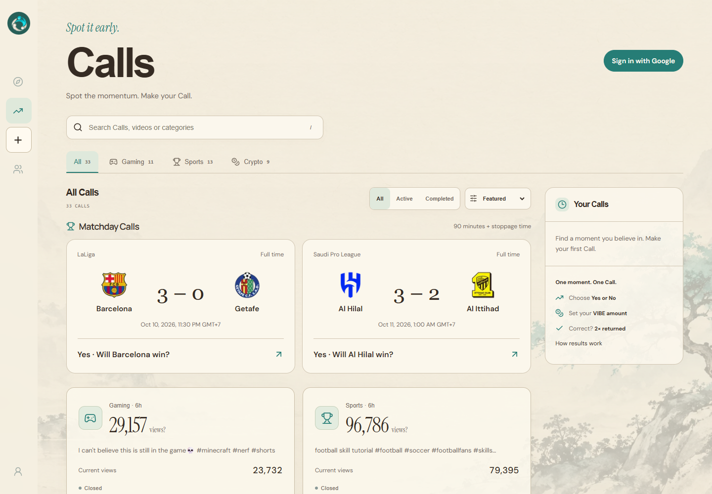

# VIBE

### Discover early. Make your Call. See the outcome.

VIBE brings short-video discovery and time-bound predictions into one experience. Watch curated Gaming, Sports and Crypto Shorts, make a Call before the outcome is known, and return to a result with a clear source and timestamp.

Built for **Metropolis — Track 03: Social, Attention & Culture**. Track selection in the submission portal is still pending.

[Open VIBE](https://web-production-5e33e.up.railway.app) · [Verified Monad result](https://web-production-5e33e.up.railway.app/live/calls/cc2aafed-4e47-486e-ba0e-ebeb1025f7aa) · [Architecture](docs/ARCHITECTURE.md) · [Setup](docs/SETUP.md) · [Submission checklist](docs/SUBMISSION_CHECKLIST.md)

## Why VIBE

People spot promising content and debate what happens next, but their original predictions disappear into the feed. VIBE connects the content, the question, the deadline and the result so that an early opinion has a record.

The intended users are curious viewers, fans and creators. The interaction is simple: **watch → make a Call → follow the outcome**. Videos without a Call remain watchable.

## Explore the product

| Area | What you can do |
| --- | --- |
| Discover | Watch 20 curated YouTube Shorts: 7 Gaming, 7 Sports and 6 Crypto. See observed views and open a Call when available. |
| Calls | Browse Yes/No questions, deadlines, progress and source evidence. Football Calls include team crests and verified full-time results. |
| Studio | Preview an MP4/WebM, add a title, caption, category and hashtags, then publish through Supabase Storage. |
| Profile | View your account, free VIBE balance, Call history and uploaded videos. |
| Community | Explore channels and shared Call discussions. Messages and comments currently remain browser-local. |
| Monad proof | Sign a separate Call with a Privy wallet, inspect the commitment, and follow reveal and settlement on Monad Testnet. |

The interface uses an ivory paper palette, teal accents, restrained motion and a mobile-first video layout. Official YouTube controls and creator attribution remain visible.



*Public desktop view captured on 11 October 2026. Scores and Call states reflect that observation, not fixed demo fixtures.*

## Two clearly defined Call flows

| | VIBE credit Calls | Monad proof Calls |
| --- | --- | --- |
| Purpose | Participate in predictions with free credits | Verify the commitment and declared outcome onchain |
| Identity | Verified Privy account | Verified Privy account and explicit wallet signature |
| Storage | Server ledger in Supabase | Monad contract, with operational records in Supabase |
| Participation | 1,000 starting VIBE; 10–500 per Call | Relayer-sponsored Testnet transaction |
| Result | Correct: 2× total return. Incorrect: no return. Void: amount refunded. | Onchain reveal and result/void transaction |
| Token movement | No purchase, transfer or cash-out | No VIBE balance debit or reward |

For example, a correct **50 VIBE** Call returns **100 VIBE total**, including the original 50. VIBE credits have no monetary value and are not an ERC-20 token. The two flows are separate in this release.

YouTube views are **periodic API observations**, not a guaranteed second-by-second stream. The server polls every 30 seconds; the displayed number changes only when the source reports a change.

## Monad integration: verified end to end

VIBE uses Monad Testnet to record a choice commitment before its deadline, reveal it after entry closes, and publish a result tied to a source snapshot. A Privy embedded wallet signs the authorization; the VIBE relayer pays Testnet gas.

| Evidence | Verified value |
| --- | --- |
| Network | Monad Testnet · chain ID **10143** |
| Contract | [`0x1a4914ec33c242b8fc781b3780c4bb0ab9bc09a5`](https://testnet.monadscan.com/address/0x1a4914ec33c242b8fc781b3780c4bb0ab9bc09a5) |
| First completed Call | 2 commitments · 2 reveals · 0 unrevealed |
| Target / observed result | 178,187,952 / **178,194,419 views** |
| Outcome | **Yes** |
| Result transaction | [View successful resolution](https://testnet.monadscan.com/tx/0x43759a61167ae2965b9a522a0315ab121a8cd0a4a4848c0884bd04b2c2a19b00) |

Receipts and contract state were verified directly on 11 October 2026. [All transaction evidence and the trust model](docs/MONAD.md).

Monad provides an EVM execution environment for the commitment lifecycle. The prototype demonstrates real contract interactions and sponsored gas; it does not claim a measured throughput advantage. YouTube data and the operator remain trusted: a snapshot hash proves which observation was declared, not that the external metric is independently true.

## Run locally

Use **Node.js 22.15 or newer within Node 22**, npm and Git. Foundry is needed for contract compilation/tests, not for browsing the local UI.

```sh
git clone https://github.com/enzerra/Project-Monad.git
cd Project-Monad
npm ci
cp .env.example .env.local
npm run dev
```

On PowerShell, replace `cp` with `Copy-Item .env.example .env.local`. Open [localhost:3000](http://localhost:3000).

The empty configuration starts local preview mode. Real YouTube data, Google login, uploads and Monad actions require their corresponding services; no credentials are bundled. [Complete setup, SQL migration order and environment reference](docs/SETUP.md).

## Technology and verification

- **App:** Next.js 16, React 19, TypeScript, Motion and Lucide.
- **Identity:** Privy Google authentication and embedded EVM wallets; server JWT verification with JOSE.
- **Persistence:** Supabase Postgres and Storage; SQLite for unconfigured local sessions.
- **Blockchain:** Solidity, Foundry and viem on Monad Testnet.
- **Sources:** YouTube Data API and official embeds; ESPN scoreboard for the curated football fixtures.
- **Hosting:** one always-running Railway Node process, with source and Monad workers.

```sh
npm test
npm run lint
npm run typecheck
npm run build
npm run test:contract
```

The application has 78 tests and the contract suite has 12. See [release evidence](docs/RELEASE.md) for dated results and their limits. Do not use test-clock results as evidence of a live event.

## Scope and current limits

- Google login, two independent accounts and the completed Monad lifecycle have been verified.
- Studio is implemented and its Storage configuration passes preflight; real authenticated publication acceptance remains pending.
- Community/comments are local prototype data. Shared persistence, moderation, reputation and an onchain leaderboard are future work.
- The Supabase engine uses a single versioned state snapshot, suitable for a small MVP. A larger service needs normalized ledgers and coordinated workers.
- The operator can decrypt choices. Privacy is from other viewers before reveal, not from the operator.
- A public demo video has **not yet been recorded** and the portal submission is **not yet complete**.

## Documentation

| Document | Contents |
| --- | --- |
| [Product specification](docs/PRODUCT.md) | Current scope and user journeys |
| [Architecture](docs/ARCHITECTURE.md) | Data flow, persistence and background workers |
| [Setup](docs/SETUP.md) | Local installation and service configuration |
| [Railway deployment](docs/RAILWAY_DEPLOYMENT.md) | Production settings, acceptance and rollback |
| [Monad integration](docs/MONAD.md) | Contract lifecycle, operator setup and receipts |
| [Source Call rules](VIBE_SOURCE_CALL_PRD.md) | Views targets, deadlines and credit settlement |
| [Football rules](docs/football-calls.md) | Entry cutoff, full time and refunds |
| [Security and limits](SECURITY.md) | Trust boundaries and operational risks |
| [Submission checklist](docs/SUBMISSION_CHECKLIST.md) | Required material and outstanding steps |
| [Assets](ASSETS.md) / [dependencies](THIRD_PARTY_NOTICES.md) | Attribution and third-party licenses |

## Build history and AI disclosure

This repository was implemented during the Metropolis build window. Earlier HIVE work informed the product concept; the project record states that code and assets from that older repository were not copied here. HIVE-named PRDs are historical planning documents, not a claim that every planned feature shipped. The team authentication branch was merged with its commit history retained.

Some technical names remain `HiveCallV2`, `hive_*` tables and `HIVE_CHOICE_V2` signature domains for compatibility. The user-facing product is VIBE.

**AI coding tools, including OpenAI Codex, assisted with code, documentation, review and testing. AI image generation was used for the original background artwork described in [ASSETS.md](ASSETS.md).** The team is responsible for reviewing and validating the submitted work. No external participation, adoption or performance metrics are invented.

## License

Application source is available under the [MIT License](LICENSE). Third-party libraries, embedded videos, fonts and club marks retain their own licenses and ownership; MIT does not relicense those assets.
