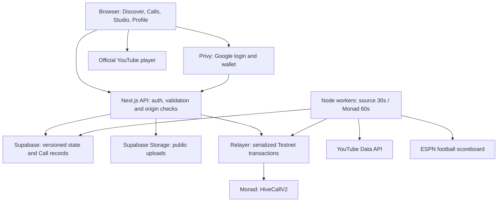

# Architecture

VIBE has one Next.js application and two prediction engines. The credit engine maintains the free VIBE ledger; the Monad engine records signed commitment proofs.

## Responsibilities

| Layer | Main files | Responsibility |
| --- | --- | --- |
| Pages and API | `src/app/` | Route rendering, public reads and authenticated actions |
| UI | `src/components/` | Video player, sheets, wallet, Studio and profile |
| Credit rules | `src/lib/source-calls.ts`, `virtual-token.ts`, `football-calls.ts` | Deterministic entry and settlement transitions |
| Persistence | `src/lib/server/vibe-store.ts` | Supabase revision-checked commits or local SQLite transactions |
| Sources | `src/lib/server/youtube.ts`, `football.ts` | Curated metadata and timestamped observations |
| Workers | `src/instrumentation.ts`, `src/lib/server/operator.ts` | Source updates, reveals and resolution |
| Contract | `contracts/HiveCallV2.sol` | Commitment authorization, deadlines, reveal, tally and terminal state |
| Database | `supabase/migrations/` | Schema, policies and state commit RPC |

## Identity and persistence

The server verifies Privy ES256 tokens, including issuer, audience and expiry. The verified DID identifies the account; client-supplied display metadata never establishes identity or wallet ownership.

Supabase stores the credit engine, observations, uploads metadata and wallet ledgers in `hive_vibe_state`. The commit RPC locks the row and compares its revision. A stale revision retries the transition instead of overwriting another account's update. Welcome grants, debits and settlements are applied atomically and only once.

Separate tables store Monad Calls, encrypted choice intents, snapshots and operator records. Service-role access stays on the server; RLS and privileges restrict direct access. Video objects reside in the public `vibe-uploads` bucket.

Without both identity and database configuration, development may use an HttpOnly cookie session and SQLite. A configured Supabase outage never silently switches accounts to SQLite or resets balances. Browser-local comments are independent of either ledger.

## Credit Call lifecycle

1. The collector observes the active curated Shorts. Archived video IDs remain tracked for existing Calls.
2. Two observations at least 30 minutes apart with positive growth qualify a candidate. One active current-selection Call per category is allowed.
3. The engine fixes the target, baseline, deadlines and rules. Entry checks identity, amount, balance, status and data freshness.
4. A valid entry debits once. At evaluation, a valid source observation resolves the question; missing evidence after the grace window causes a refund.
5. The public API exposes Call/source evidence; authenticated responses additionally contain the caller's wallet.

Football uses the same account ledger, with exact fixture IDs and a verified full-time result in place of a views target.

## Monad lifecycle

A wallet signs a Call-specific authorization. The backend stores the choice and salt encrypted, then the relayer sends the commitment. Only a confirmed receipt establishes an onchain choice. The operator reveals after entry closes and resolves after evaluation using a timestamped YouTube snapshot.

The contract and relayer are separate from the VIBE credit ledger. [Details and receipts](MONAD.md).

## Timing and deployment

- Source collector: every 30 seconds.
- Account/Call client refresh: every 15 seconds.
- Video views client refresh: every 30 seconds.
- Monad keeper: every 60 seconds when configured.
- Run one always-on process/replica. In-process queues prevent overlapping operator work; they are not a distributed job system.
- Store timestamps in UTC. The interface presents explicit Jakarta/GMT+7 timing.

Supabase persists state but does not run these Node timers. Railway must remain active when browsers close. See [deployment](RAILWAY_DEPLOYMENT.md) and [security limits](../SECURITY.md).
